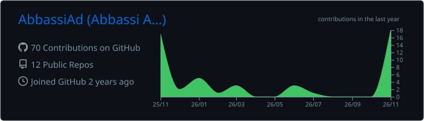
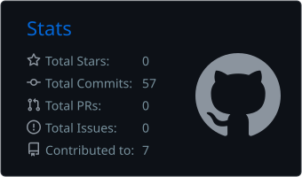
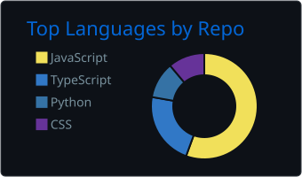
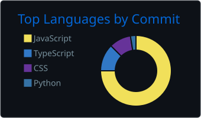
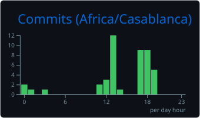

<h2>06 / GitHub Activity</h2>

  

    <strong>Building consistently. Learning through every contribution.</strong>
  

  

    A snapshot of my projects, contributions and development habits.
  

  

<table width="100%">
  <tr>
    <td width="50%" align="center" valign="top">
      <h3>Development Overview</h3>
      
Commits, pull requests and contributions

      
    </td>
    <td width="50%" align="center" valign="top">
      <h3>Languages Across Projects</h3>
      
Language distribution across repositories

      
    </td>
  </tr>
  <tr>
    <td width="50%" align="center" valign="top">
      <h3>Languages in Practice</h3>
      
Language distribution across commits

      
    </td>
    <td width="50%" align="center" valign="top">
      <h3>Coding Rhythm</h3>
      
Commit activity throughout the day

      
    </td>
  </tr>
</table>

  

    
    
  

  

    Activity cards refreshed daily via GitHub Actions.
  

