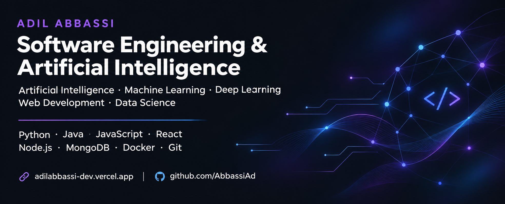
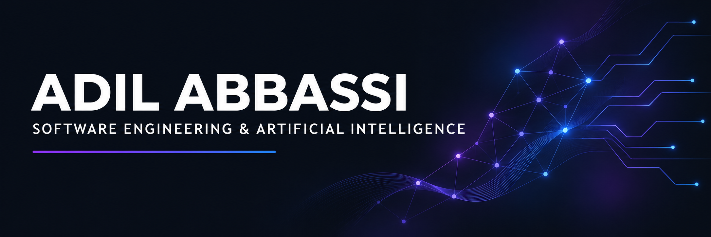
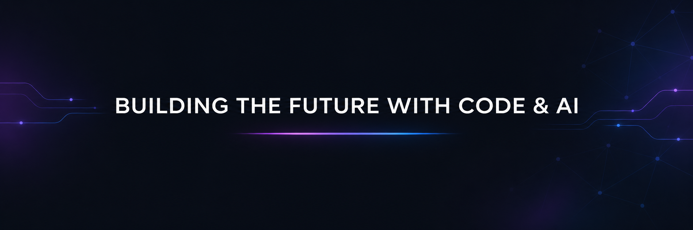

<!--
Adil Abbassi · GitHub profile
Place header.png, banner.png and footer.png beside this README.md.
Palette: #0D1117 · #6366F1 · #8B5CF6 · #3B82F6 · #CBD5E1
External badges and activity cards are optional and depend on their providers.
-->
 
 ENGINEERING STUDENT · SOFTWARE DEVELOPER · AI ENTHUSIAST

Building useful applications. Exploring intelligent systems. Learning through real projects.

  
  
  

  <a href="#about">About</a> &nbsp; / &nbsp;
  <a href="#projects">Projects</a> &nbsp; / &nbsp;
  <a href="#experience">Experience</a> &nbsp; / &nbsp;
  <a href="#stack">Tech Stack</a> &nbsp; / &nbsp;
  <a href="#activity">Activity</a> &nbsp; / &nbsp;
  <a href="#connect">Contact</a>

01 / About
I'm Adil Abbassi, a Software Engineering & Artificial Intelligence engineering student at the Faculty of Sciences and Techniques of Errachidia, Morocco.

My interests connect full stack development with applied AI: building web and mobile experiences, designing APIs, and using data to support predictions and recommendations. Through internships and personal projects, I've worked on applications spanning education, e-commerce, football and real-estate analytics.
Open to opportunities and collaboration in software engineering, artificial intelligence and data science.

02 / Selected Projects
<table>
<tr>
<td width="50%" valign="top">
<h3>01 &nbsp; ClassDil</h3>

<strong>Education · Full Stack</strong>

An educational platform inspired by Google Classroom, with dedicated spaces for teachers and students.

  

</td>
<td width="50%" valign="top">
<h3>02 &nbsp; GraphSAGE</h3>

<strong>AI · Recommendation Systems</strong>

A graph-based recommendation project exploring user–product relationships to generate personalized recommendations.

  

</td>
</tr>
<tr>
<td width="50%" valign="top">
<h3>03 &nbsp; Ad-Foot</h3>

<strong>Mobile · Sports</strong>

A football mobile application bringing together scores, match information and sports events.

 

</td>
<td width="50%" valign="top">
<h3>04 &nbsp; E-Shop</h3>

<strong>E-commerce · Full Stack</strong>

A full stack shopping application featuring product management, user accounts and order processing.

 

</td>
</tr>
</table>

<strong>Also built: ARTWARE — Digital Club Platform</strong>
A web platform for managing club activities and content, including an administration module.

  

03 / Professional Experience
Data & AI Intern · Orchid Island
June – August 2026   ·   Marrakech, Morocco
- Contributed to a predictive analytics platform for real-estate market analysis and investment opportunities in Marrakech-Safi.
- Developed predictive models with Python, CatBoost and LightGBM.
- Integrated AI functionality into a MERN stack application.
Web Development Intern · Evolux Agency
June – September 2025   ·   France
- Contributed to Evolux Events, an event management platform.
- Developed frontend and backend functionality with the MERN stack.
- Designed and integrated RESTful APIs.

<strong>Earlier experience · IT systems & support</strong>
IT Systems Intern · GOCOM INWI
April – June 2024 · Casablanca, Morocco
- Participated in developing an IT helpdesk system covering ticket creation, assignment, tracking and resolution.
- Contributed to frontend, backend and database development.
IT Intern · Royal Mansour Marrakech
August – September 2023 · Marrakech, Morocco
- Assisted with IT support, troubleshooting, maintenance and equipment management.

04 / Technical Stack

  
  
  

Languages
Web & Mobile
React Native · Full stack development · RESTful APIs
Databases & Tools
AI & Data
Area	Focus
Machine Learning	Predictive analytics · CatBoost · LightGBM
Deep Learning	Graph neural networks · GraphSAGE
Data Science	Data analysis · Recommendation systems
Currently exploring	Generative AI · LLMs · RAG · AI agents · MLOps · Computer vision

<strong>Additional knowledge</strong>
- Network programming: TCP/IP, UDP and sockets.
- Agile / Scrum.
- Blockchain & Web3.
- Cybersecurity fundamentals.

05 / Education & Recognition
Qualification	Institution	Year
Engineering Cycle · Software Engineering & AI	Faculty of Sciences and Techniques of Errachidia	Since 2025
DUT · Computer Engineering	Higher School of Technology of Meknes	2024
Baccalaureate · Physical Sciences, French Option	With Honors	2022

<table>
<tr>
<td width="50%" valign="top">
<h3>🥇 Impact & Public Utility Award</h3>

<strong>RamadanIA Hackathon</strong>

Contributed to <strong>2Views</strong>, a tourism-oriented solution for the Drâa-Tafilalet region.

</td>
<td width="50%" valign="top">
<h3>🥉 3rd Place</h3>

<strong>Hult Prize · FST Errachidia</strong>

Participated in the development of <strong>Cinemate</strong>.

</td>
</tr>
</table>
 

## 06 / GitHub Activity

### Contribution Activity

 

### GitHub Statistics

 

### Most Used Languages

07 / Let's Connect

Have a project or an opportunity in mind?
I'd love to discuss software development, applied AI and ideas we could build together.

Arabic — Native   ·   French — Professional   ·   English — Professional

<a href="mailto:abbassiadil67@gmail.com">abbassiadil67@gmail.com</a>

